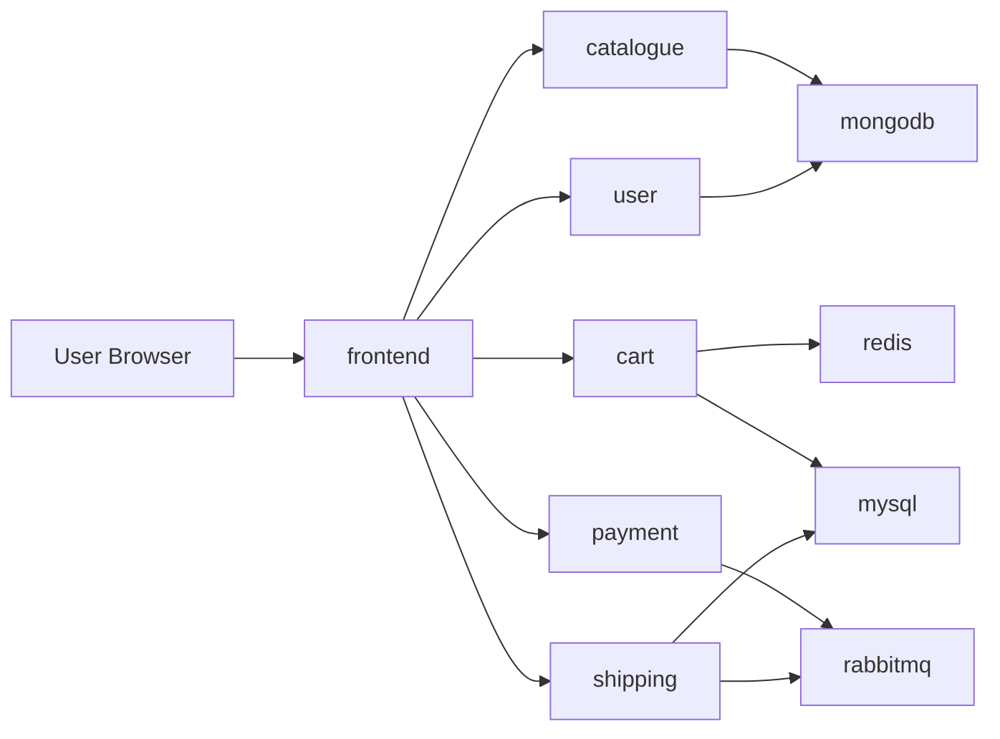

# RoboShop Docker

This repository contains a Docker Compose based deployment for the RoboShop application. It packages the storefront and supporting backend services so they can run together on a single host or local development environment.

## Project Overview

RoboShop is a multi-service e-commerce application composed of a frontend, several business services, and supporting infrastructure components such as MongoDB, Redis, MySQL, and RabbitMQ. This repository demonstrates how those services can be composed into a single local environment using Docker Compose.

## Problem Statement

Microservice applications are easier to reason about when each component can be run in isolation, but they also require a consistent startup and networking model. This repository provides a simple orchestration layer for local development and validation.

## Key Features

- Docker Compose based orchestration
- Multi-service application topology
- Service-level containerization
- Named volumes for persistent state
- Local environment simulation for application dependencies
- Reusable portfolio example for Docker and DevOps workflows

## Architecture Overview

The application is organized into UI, application logic, and data/messaging services.



## Technology Stack

- Docker
- Docker Compose
- Linux containers
- MongoDB
- Redis
- MySQL
- RabbitMQ
- Microservice application code

## Repository Structure

```text
.
├── README.md
├── docker-compose.yaml
├── frontend/
├── cart/
├── catalogue/
├── user/
├── payment/
├── shipping/
├── mongodb/
├── mysql/
├── redis/
├── rabbitmq/
└── debug/
```

## Prerequisites

- Docker Engine
- Docker Compose
- CPU and memory available for multiple containers
- Internet access to pull base images

## Installation and Usage

Clone the repository and run:

```bash
docker compose up -d
```

To stop the environment:

```bash
docker compose down
```

To rebuild containers after source changes:

```bash
docker compose up -d --build
```

## Configuration

The Compose file defines service names, environment variables, ports, networks, and volume mounts. Most configuration is centralized in `docker-compose.yaml` and service-specific folders.

## Build and Deployment Notes

This repository is intended for local development and learning workflows rather than production deployment. Image tags such as `ravidasari145/<service>:1.0.0` are used in the Compose definitions.

## Security

- Services are intentionally local and development-oriented
- No production secrets are committed to the repository
- Network isolation is provided by Docker networking rather than cloud network policies

## Testing and Validation

Validate startup by checking container status:

```bash
docker compose ps
```

Inspect logs when needed:

```bash
docker compose logs -f
```

## Current Implementation Status

- Local multi-service environment is defined
- Compose configuration is present and usable for development
- Service dependencies are modeled in the stack

## Known Limitations

- Not designed for production-grade deployment
- No CI pipeline is included in this repository
- Local environment behavior depends on Docker host resources

## Future Improvements

- Add health checks and readiness probes
- Document service dependency order and troubleshoot commands
- Add environment-specific compose files
- Add automated smoke tests

## Related Repositories

- [roboshop-ansible](https://github.com/dasariravi145/roboshop-ansible)
- [ansible-roboshop-roles](https://github.com/dasariravi145/ansible-roboshop-roles)
- [k8-roboshop](https://github.com/dasariravi145/k8-roboshop)
- [roboshop-infra-dev](https://github.com/dasariravi145/roboshop-infra-dev)
- [roboshop-infra-eks](https://github.com/dasariravi145/roboshop-infra-eks)
